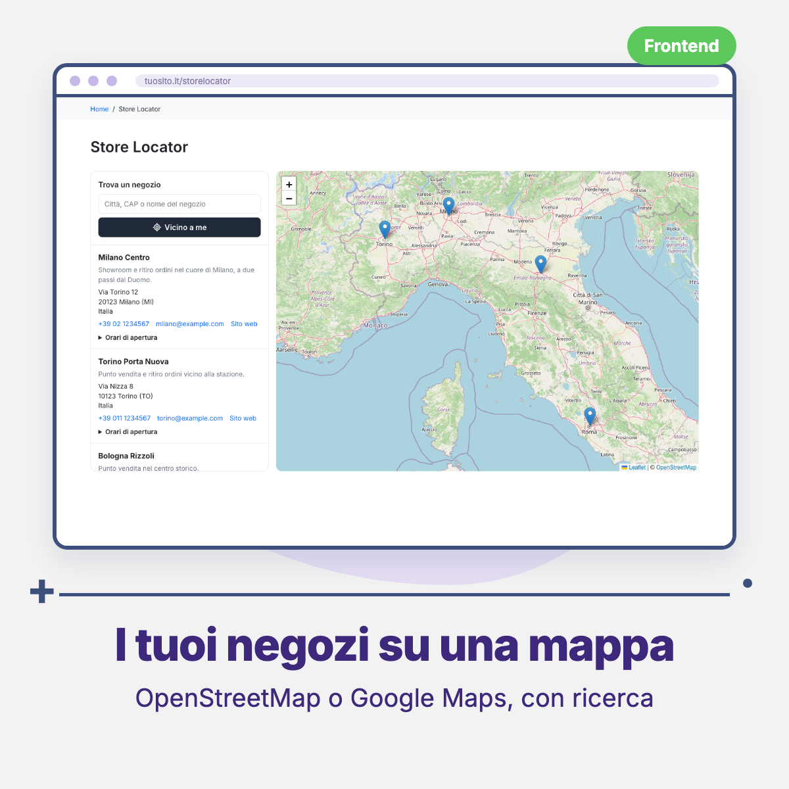
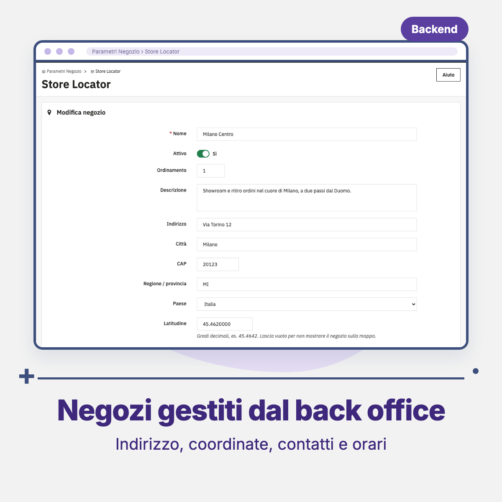

# Threecommerce Store Locator: store locator for PrestaShop

A **store locator** page for PrestaShop: a list of your stores with an **OpenStreetMap** or **Google Maps** map (your choice, from the back office), search by city, postcode or name, "near me" and opening hours. Stores are managed from the back office. It is the PrestaShop port of our Magento 2 store locator.

**Compatibility:** PrestaShop 8.0+ / 9.x declared (tested on 9.1.4) · PHP 8.1+ · Hummingbird theme tested
**License:** commercial · coming soon

## Features

- **Stores in the back office**: *Shop Parameters → Store Locator* with name, status, sort order, description, address, country, **latitude/longitude**, phones, email, website, Facebook, X/Twitter and **opening hours** for each day. With multistore each store is associated to the PrestaShop shops where it must appear.
- **Map provider** chosen from the module configuration: **OpenStreetMap** (default, no key and no account; Leaflet 1.9.4 is bundled, no CDN) or **Google Maps** (API key and optional Map ID).
- **Front end**: server-rendered list (Smarty) with only the active stores of the current shop. The map loads only when it scrolls into view; a click on a store or marker centers the map and opens an info window with name, address, phone and a "Get directions" link.
- **Search** that filters list and map, and **Near me** that sorts stores by distance (computed in the browser, needs the location permission).
- Vanilla JavaScript (no jQuery); colors and height can be set from the theme with `--tc-storelocator-*` CSS variables.
- Configuration: enable, page title and meta tags per language, page URL, map provider, Google key and Map ID, zoom (1-20), HTML before and after the map.
- Extension hooks (`actionTcStorelocatorStoreFormModifier`, `actionTcStorelocatorStoreSave`) used by our Store Pickup module. Italian translation included.

## Requirements

- PrestaShop 8.0 or newer, or 9.x
- PHP 8.1 or newer
- With OpenStreetMap nothing else is needed. With Google Maps you need an API key with the *Maps JavaScript API* enabled; without a key the page still shows the store list

## Tested with

PrestaShop 9.1.4 with the Hummingbird theme. PrestaShop 8, the Classic theme and Google Maps with a real API key have **not** been tested yet.

## Availability

This module is **not yet available for purchase**. See the [product page](https://www.threecommerce.it/store-locator-prestashop?utm_source=github&utm_medium=readme&utm_campaign=prestashop-store-locator) for its status, or [get in touch](https://www.threecommerce.it/contatti?utm_source=github&utm_medium=readme&utm_campaign=prestashop-store-locator) to be notified at launch or to ask for information.

## Configuration

Back office → **Modules → Store Locator → Configure**: enable, page title, page URL (default `storelocator`, needs friendly URLs), map provider, Google API key and Map ID, zoom, HTML before and after the map, SEO. Stores are managed in **Shop Parameters → Store Locator**.

## Documentation and support

- Product page: [threecommerce.it/store-locator-prestashop](https://www.threecommerce.it/store-locator-prestashop?utm_source=github&utm_medium=readme&utm_campaign=prestashop-store-locator)
- [Changelog](CHANGELOG.md) (in Italian)
- Support and custom development: [threecommerce.it/contatti](https://www.threecommerce.it/contatti?utm_source=github&utm_medium=readme&utm_campaign=prestashop-store-locator)

---

*This repository is the public showcase of the module. The source code is kept in a private repository.*
